# 💫 About Me:
✍️ I'm currently working on: Building Java-based projects, including a Payment Gateway System.  👥 I'm looking to collaborate on: Java, Backend Development, and Open Source Projects.  💛 I'm looking for help with: Improving my problem-solving skills and learning industry-level software development practices.  🌱 I'm currently learning: Core Java, OOP, Collections Framework, Java Streams, Lambda Expressions, Exception Handling, and Backend Development.  💬 Ask me about: Java Programming, Object-Oriented Programming, Collections, and my Payment Gateway Project.  ⚡ Fun fact: I love learning new technologies and turning theoretical concepts into practical projects!

## 🌐 Socials:
   

# 💻 Tech Stack:
                                

# 📊 GitHub Stats:
 
 

## 🏆 GitHub Trophies

### 🔝 Top Contributed Repo

---

<!-- Proudly created with GPRM ( https://gprm.itsvg.in ) -->
